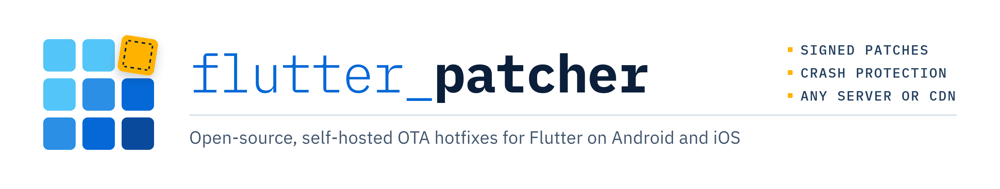

<picture>
  <source media="(prefers-color-scheme: dark)" srcset="doc/assets/banner-dark.png">
  
</picture>

[](https://pub.dev/packages/flutter_patcher)
[](https://github.com/xuelinger2333/flutter_patcher/actions/workflows/ci.yml)
[](LICENSE)

[English](README.md) | **简体中文**

**开源、自托管的 Flutter 热更新工具（支持 Android 与 iOS）。** 线上出了紧急 Bug，不用等商店审核，直接从你自己的服务器或 CDN 把修复推给用户。

flutter_patcher 是一个带命令行工具的 Flutter 插件：

1. `build` 构建你要发布的 App。
2. 修复问题后，`patch` 生成一个补丁文件。
3. 把文件放到自己的 HTTPS 服务器上。App 下载它，从下次冷启动开始运行。

原生代码和 Flutter 版本的改动仍然需要发布商店版本。

## 环境要求

| Flutter | Android | iOS |
|---|:---:|:---:|
| 3.47.0 – 3.47.9 | ✅ | ✅ |

| 用途 | 需要 |
|---|---|
| Android 设备 | Android 9（API 28）或更新版本，`arm64-v8a` |
| iOS 设备 | iOS 13 或更新版本 |
| `build android` | Linux x64、Windows x64 或 Apple Silicon Mac |
| `build ios` | 装有 Xcode 的 Apple Silicon Mac |
| `patch android`、`patch ios` | 以上任意一种电脑 |

## 可更新范围

| 改动 | 能否更新 | 原因 |
|---|:---:|---|
| 你的 Dart 代码 | ✅ | |
| 纯 Dart 依赖，例如 `dio`、`intl` | ✅ | |
| 新增或修改的图片、字体等资源 | ✅ | |
| 删除资源 | ❌ | 补丁只能覆盖资源，不能删除 |
| 原生代码、平台插件和 FFI 包，例如 `mmkv`、`isar` | ❌ | 补丁只携带 Dart 代码和资源 |
| Flutter SDK 版本 | ❌ | 补丁必须用构建该版本的 Flutter 生成 |

`patch` 会检查这些限制，改动违反其中任意一条时，将以错误码失败。完整列表见[工作原理](doc/architecture-zh.md#能更新什么)。

## 快速开始

1. 添加依赖，初始化，并检查补丁：

   ```bash
   flutter pub add flutter_patcher:1.1.1
   dart run flutter_patcher init   # 初始化配置文件
   ```

   ```dart
   Future<void> main() async {
     WidgetsFlutterBinding.ensureInitialized();
     await FlutterPatcher.init(); // 初始化 flutter_patcher，需在 runApp 之前调用
     runApp(const MyApp());
   }

   // 检查远端有没有新补丁，默认地址是 serve 提供补丁的 127.0.0.1:8686
   final check = await FlutterPatcher.checkUpdate();
   if (check.hasUpdate) {
     // 下载并校验补丁，下次冷启动生效
     await FlutterPatcher.applyPatch(check.patch!);
   }
   ```

2. 构建 App 并安装。`build` 同时记录基线，作为打补丁的对比基础：

   ```bash
   dart run flutter_patcher build android   # 或 build ios，需在 Mac 上运行
   ```

3. 修改 Dart 代码，然后生成补丁。`patch` 在输出的 `file` 中给出补丁文件的路径：

   ```bash
   dart run flutter_patcher patch android   # 写出一个文件，例如 1-arm64-v8a.fptc
   ```

4. 向通过 USB 连接的手机提供补丁，然后打开 App ：第一次启动，应用自动安装补丁；第二次启动，应用运行补丁。

   ```bash
   dart run flutter_patcher serve   # 在 127.0.0.1:8686 提供最新的补丁，仅用于开发
   ```

具体步骤见[快速上手](doc/getting-started-zh.md)。

## 上线之前

为了开发调试便利，flutter_patcher 将三项主要功能设为可选；强烈建议在构建正式版本宿主前，逐一打开三项功能：

- **更新地址**：用 `checkUpdate(url: …)` 传入提供补丁文件的正式 HTTPS 地址。另外，有[自定义下发](doc/advanced-zh.md#由自家服务端自定义下发)需求的开发者可以通过自行获取补丁，并加载补丁文件的方法安装。
- **基线存储**：在 `flutter_patcher.yaml` 的配置中把 `baseline_store` 设为持久存储，一旦基线丢失，对应的构建无法再打补丁（`WARNING: BASELINE_STORE_LOCAL`）。
- **签名**：在 `flutter_patcher.yaml` 中设置 `trust.enabled: true`，开启宿主签名。不签名的 App 允许安装本构建的任何完整补丁文件，容易被攻击（`WARNING: UNSIGNED`）。

具体步骤见[生产部署](doc/production-playbook-zh.md)。

> **注意**
> 部分应用商店和受监管行业限制下载可执行代码。按你发布的商店的规则确认。

## 文档

| 文档 | 内容 |
|---|---|
| [快速上手](doc/getting-started-zh.md) | 从添加依赖到补丁在手机上运行 |
| [工作原理](doc/architecture-zh.md) | 宿主、基线、两种补丁策略、安全模型、能更新什么 |
| [CLI 参考](doc/cli-zh.md) | 每个命令、选项、输出和退出码；`flutter_patcher.yaml` |
| [API 参考](doc/api-reference-zh.md) | App 调用的 Dart API |
| [生产部署](doc/production-playbook-zh.md) | 托管补丁文件、保管基线、签名、回滚、从 1.0 升级 |
| [进阶操作](doc/advanced-zh.md) | KMS 签名、CI 中的密钥、停止签名、自定义宿主策略、S3、由自家服务端下发 |
| [从 1.0 升级](doc/upgrading-zh.md) | 继续为用 1.0.0 上线的 App 打补丁 |
| [崩溃保护](doc/crash-protection-zh.md) | 补丁启动失败时会发生什么；启动诊断 |
| [错误码与排障](doc/troubleshooting-zh.md) | 每个错误码和警告及其处理方法 |
| [常见问题](doc/faq-zh.md) | 简短回答和链接 |

## 参与贡献

欢迎提交 Issue 和 Pull Request。提交之前运行：

```bash
flutter pub get
flutter analyze
flutter test
```

改动原生代码时，还需要运行 [`test/acceptance`](test/acceptance/README.md) 中的真机验收测试，因为单元测试不会在设备上加载补丁。

## 许可证

[MIT](LICENSE)
